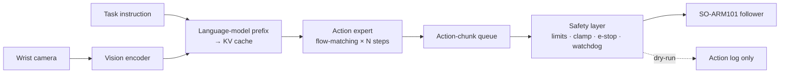

<div align="center">

# edge-ai-engine

**Running vision-language-action robot policies on an 8 GB edge computer — and measuring every millisecond.**

SmolVLA → pi0 → world models · NVIDIA Jetson Orin Nano · SO-ARM101 · LeRobot · TensorRT


[Project website](#project-website) · [Roadmap](docs/ROADMAP.md) · [Design decisions](docs/decisions/) · [Research](docs/research/) · [Learning log](docs/learning/) · [Jetson quirks](docs/jetson-quirks.md)

</div>

---

## What this is

Vision-language-action (VLA) models look at camera images, read an instruction like
*"pick up the cube and put it in the bowl"*, and output robot arm motions. They are usually
run on big desktop GPUs. This project asks: **how far can you push them on a $249, 8 GB,
25 W Jetson Orin Nano driving a real low-cost arm — and what does each optimization actually buy you?**

It is also my learning log. Every step — from bring-up to TensorRT INT8 — is documented with
what I tried, what broke, and the numbers.

## Goals

1. **Deploy** SmolVLA (~450M params) on the Orin Nano in a real-time control loop for the SO-ARM101.
2. **Optimize** it step by step — PyTorch FP32 → FP16/BF16 → TensorRT FP16 → TensorRT INT8 → INT4 —
   plus action-chunk size and async inference.
3. **Benchmark** every step reproducibly: latency (p50/p95), control frequency, peak memory,
   power, and accuracy vs. the FP32 reference.
4. **Migrate** to pi0 (~3.3B params) with quantization and report whether it is feasible on 8 GB, and at what cost.
5. **Explore** world models, if time allows.

## Hardware

| Component | Details |
|---|---|
| Inference | NVIDIA Jetson Orin Nano 8 GB · JetPack 6.2 · MAXN SUPER (25 W) |
| Robot | SO-ARM101 leader + follower (Feetech STS3215 servos) |
| Camera | 1× wrist-mounted USB camera |
| Training | x86 workstation · NVIDIA RTX 2000 Ada (16 GB) · Ubuntu 22.04 |

## Architecture



The policy is split into **three separately optimizable stages** (vision encoder, LM prefix, action
expert). That split is what makes TensorRT export practical and lets the benchmarks show where the
time goes. See [ADR-0001](docs/decisions/0001-tensorrt-as-primary-optimization-path.md).

## Roadmap

| Phase | Milestone | Status |
|---|---|---|
| A · SmolVLA | M0 Repo + environment (both machines) | 🟡 in progress |
| | M1 Safety layer + dry-run mode | ⚪ |
| | M2 Arm bring-up: motors, calibration, teleop | ⚪ |
| | M3 Public dataset selection + visualization | ⚪ |
| | M4 Fine-tune SmolVLA | ⚪ |
| | M5 Deploy on Jetson (sync + async control loops) | ⚪ |
| | M6 Benchmark harness | ⚪ |
| | M7 Optimization ladder (TensorRT FP16/INT8, INT4, chunk sizes) | ⚪ |
| | M8 Write-up A | ⚪ |
| B · pi0 | M9 Quantize + deploy pi0 on the Orin Nano, feasibility verdict | ⚪ |
| C · World models | M10 Scoping, then build if time allows | ⚪ |

Details and acceptance criteria: [docs/ROADMAP.md](docs/ROADMAP.md).

## Results

> 🚧 Benchmarks arrive in **M6**. This table will be generated by `bench/run_all.sh` — never edited by hand.

| Model | Config | Latency p50 / p95 (ms) | Control Hz | Peak mem (GB) | Power (W) | Accuracy vs FP32 | Real success |
|---|---|---|---|---|---|---|---|
| SmolVLA | PyTorch FP32 | — | — | — | — | ref | — |

## Repository layout

```
edge-ai-engine/
├── src/edge_ai_engine/   # policy wrappers, control loop, safety layer, export code
├── configs/              # robot, camera, safety limits, training, benchmark configs
├── scripts/
│   ├── jetson/           # [JETSON] setup, bring-up, deploy, engine builds
│   └── train/            # [TRAIN] setup, fine-tuning, offline eval
├── bench/                # single-command reproducible benchmark harness
├── results/              # benchmark outputs (JSON/CSV), generated tables & plots
├── docs/                 # roadmap, design decisions (ADRs), Jetson install quirks
└── site/                 # interactive project website (GitHub Pages)
```

Every script is tagged **`[JETSON]`** or **`[TRAIN]`** for the machine it runs on.

## Getting started

> 🚧 Setup scripts land in **M0**. Pinned versions and every Jetson-specific install quirk will be
> recorded in [docs/jetson-quirks.md](docs/jetson-quirks.md).

## Safety

This project moves a real robot arm. The control stack enforces:

- joint position / velocity / torque limits from config
- a per-step action-delta clamp and workspace bounds
- a keyboard e-stop that disables torque, plus a **physical power-cut switch** (recommended)
- a watchdog that holds position on stale camera frames or policy outputs
- `--dry-run` mode that logs actions without sending them to the motors

## Project website

An interactive site (pipeline explorer, roadmap tracker, and — once benchmarks exist — sortable
results) lives in [`site/`](site/). Preview locally:

```bash
python3 -m http.server -d site 8000   # then open http://localhost:8000
```

It will be published with GitHub Pages when the repo goes public.

## Acknowledgements

Built on [🤗 LeRobot](https://github.com/huggingface/lerobot), [SmolVLA](https://huggingface.co/lerobot/smolvla_base),
[pi0](https://www.physicalintelligence.company/blog/pi0) by Physical Intelligence, the
[SO-ARM100/101](https://github.com/TheRobotStudio/SO-ARM100) by The Robot Studio, and NVIDIA JetPack / TensorRT.

## License

[MIT](LICENSE)
